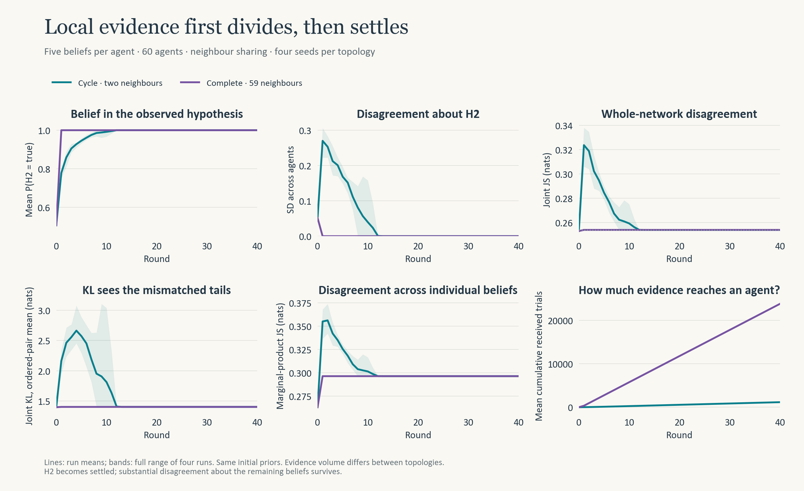
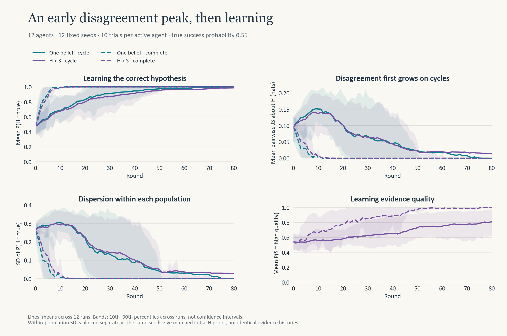

# Beliefs within networks

An exploratory study of local evidence sharing, factionalization and Bayesian
source reliability. The main simulations use the PolyGraphs operations on DGL
graphs. Separate shared-evidence controls check the published belief structures.

Open [results.html](results.html) locally for the complete illustrated report, or
download the [PDF figure atlas](figure-atlas.pdf). Figures are available as PNG and
SVG in [figures](figures); raw trajectories and CSV tables are in [data](data).





The study contains 120 small bandit/reliability runs, eight networked five-node
runs, three shared-evidence trajectories and 200 prior-sensitivity checks. Seeds,
parameters and compute timings are recorded with the data. Runs are exploratory;
their bands describe run-to-run spread, not confidence intervals.

With the repository installed and R bnlearn/gRain configured, the reproduction
order is:

```bash
python reports/2026-11-17/run_study.py
python reports/2026-11-17/run_networked_factions.py
python reports/2026-11-17/analyse_checks.py
python reports/2026-11-17/make_report.py
python reports/2026-11-17/validate_outputs.py
```

The first two commands perform simulations. The latter commands analyse saved
arrays and render the report. The two simulation batches took about 91 seconds
combined on the development machine.
`checksums.sha256` records the binary trajectory, PNG and PDF files.

The report distinguishes expected directed-KL contraction from realised changes
and from equal-weight posterior JS. It gives a concrete JS counterexample and
checks the appropriate KL and weighted-JS identities. It also identifies the
truth/reliability symmetry of the 50:50 opposite-reporting model.
